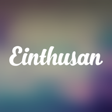
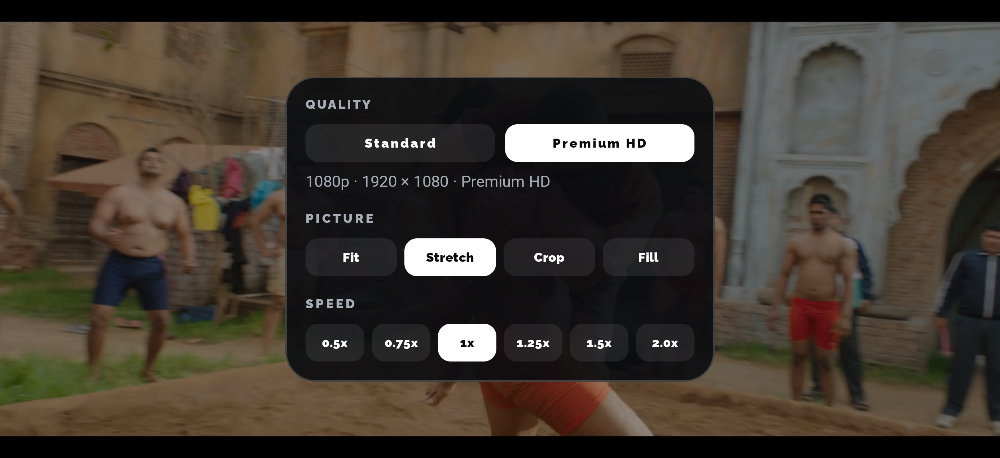

  

<h1 align="center">Einthusan for Android</h1>

Browse South Asian cinema. Save your next watch. Pick up where you left off.

  Android 8.0+ · Native Android app · Unofficial Einthusan client

  <a href="#features">Features</a> ·
  <a href="#get-started">Get started</a> ·
  <a href="#player-controls">Player controls</a> ·
  <a href="#documentation">Documentation</a> ·
  <a href="https://github.com/galleryninestudio-ops/einthusan-app/issues">Report an issue</a>

Einthusan for Android brings film discovery, streaming, downloads, and a personal
watchlist into one native app. Explore films in eight languages, continue a movie
from your saved position, or download it to watch later.

This is an independent project and is not affiliated with or endorsed by Einthusan.
Film availability and account access depend on Einthusan's service.

## A player you can adjust

  

Choose your picture fit and playback speed in one panel. With a signed-in Premium
account, the same panel offers Standard and Premium HD for supported films.
The player shows the video’s actual resolution alongside the selected quality.

## Features

- **Discover films in eight languages.** Browse Tamil, Hindi, Telugu, Malayalam,
  Kannada, Bengali, Marathi, and Punjabi cinema. Explore recent releases, staff
  picks, regional hits, alphabet lists, and decades, or search your selected language.
- **Keep a personal watchlist.** Save films for later and return to your recent
  movies through Continue Watching.
- **Resume where you stopped.** Playback progress is saved locally on your device.
- **Watch offline.** Download films, pause and resume transfers, and play completed
  downloads from your library.
- **Make the picture fit.** Choose Fit, Stretch, Crop, or Fill, or pinch with two
  fingers to zoom from 1× to 4× and pan while zoomed.
- **Stay in control.** Adjust speed from 0.5× to 2×, seek with a double tap, change
  brightness and volume with swipes, and lock the player controls.
- **Keep watching in picture-in-picture.** Use the floating player’s play and pause
  controls while using another app. Closing it stops playback.

## Get started

The app requires **Android 8.0 or later**. An Einthusan account is optional;
Premium HD requires an existing Premium account and a supported film.

**A public APK release has not been published yet.** To install from this repository,
follow the [build guide](docs/DEVELOPMENT.md#build-and-checks) to create an APK,
then open it on your Android device to install it.

Once installed:

1. Choose a language and browse or search for a film.
2. Open its details to play, save, or download it.
3. Open Account to sign in if you want to use your Premium access.

For updates, use an APK signed with the same key as your installed copy to preserve
app data. See the [signing notes](docs/DEVELOPMENT.md#build-and-checks) before
switching between debug and release builds.

## Player controls

| Action | Control |
| --- | --- |
| Show or hide controls | Tap the video |
| Seek backward or forward 10 seconds | Double-tap the left or right half |
| Adjust brightness | Swipe vertically on the left |
| Adjust volume | Swipe vertically on the right |
| Zoom in or out | Pinch with two fingers |
| Move the zoomed picture | Drag with two fingers |
| Reset zoom | Pinch back to 1× or select a picture-fit mode |
| Change quality, picture fit, or speed | Open player settings |
| Prevent accidental input | Lock the player controls |

Pinch zoom requires a deliberate hold and spacing change to reduce accidental
zooming when a second finger briefly touches the screen.

## Premium and video quality

Premium HD appears when you are signed in with a Premium account. Available quality
still depends on the film and the stream provided by Einthusan.

An **HD** catalogue badge indicates a higher-quality option; it does not confirm
4K. The player reports the decoded video dimensions, such as **1920 × 1080**, and
only displays a 4K label when the decoded dimensions meet its 4K threshold.
Choosing Premium HD does not guarantee a 4K stream. See [how quality is detected](docs/PLAYBACK.md#video-quality).

## Your library and account

Watchlists and resume positions are stored on your device and are **not synced
through your Einthusan account**. Updates with a matching signing key preserve
them; clearing app data or uninstalling removes the local history. Android device
backup is separate from account sync.

Passwords are not saved. The app retains session cookies and stores the saved
email using Android Keystore encryption. Completed downloads are saved in
`Movies/Einthusan/` and can remain after uninstalling.
Read the [storage guide](docs/STORAGE.md) for details.

## Current limitations

- Separate subtitle-track selection is not available. Some films include burned-in subtitles.
- A download link can expire during a long pause; automatic link renewal is not implemented.
- Android 8–9 requires shared-storage permission to save completed downloads.
- Changes to Einthusan’s website or media servers can affect browsing, sign-in, and playback.

## Documentation

The app uses Kotlin, Jetpack Compose, and Media3 for native playback.

- [Development](docs/DEVELOPMENT.md) — build instructions, signing, source structure, and deep links.
- [Playback and downloads](docs/PLAYBACK.md) — quality detection, gestures, caching, downloads, and PiP behavior.
- [Storage and account data](docs/STORAGE.md) — watch progress, preferences, sessions, and downloaded files.
- [Release verification](docs/RELEASE_VERIFICATION.md) — recorded APK and certificate checks.

Found a problem? [Open an issue](https://github.com/galleryninestudio-ops/einthusan-app/issues)
with your Android version, app version, steps to reproduce, and the film and language
if relevant. Remove account details and session links from screenshots and logs.
